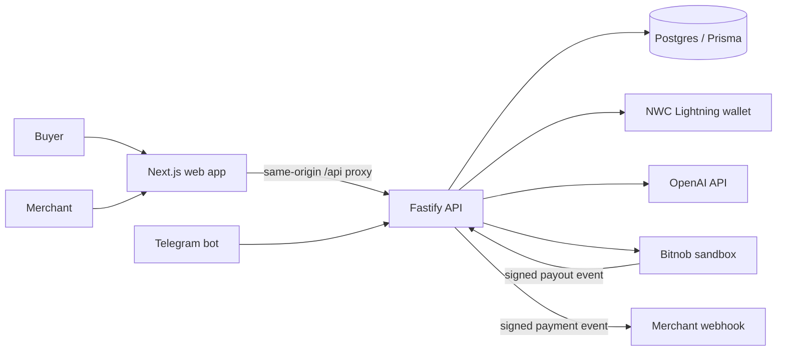

# Flow by RPay

Flow is a Lightning commerce workspace for small merchants. A merchant can publish products in a storefront, share a reusable product link, create a one-off checkout, and see who paid. Buyers receive a hosted invoice and pay from a compatible Lightning wallet. The dashboard also includes withdrawals, an AI assistant, developer keys, and webhook settings.

**Live demo:** [flow.rpay.space](https://flow.rpay.space) · **Developer docs:** [flow.rpay.space/docs](https://flow.rpay.space/docs) · **API health:** [flow-rpay-api.vercel.app/health](https://flow-rpay-api.vercel.app/health)

> This deployment is a sandbox demo. Its NWC faucet sats have no mainnet value. Do not use the seeded demo account or test wallet for real funds.

## What works today

| Area | Current behavior |
| --- | --- |
| Storefront and links | A merchant creates products once; buyers can reuse the store or product link for separate orders. |
| Checkout | Flow creates a Lightning invoice, shows its amount, expiry, QR code, and payment status. Buyers can provide a name and email for the merchant's order record. |
| Merchant workspace | Shows balance, recent payments, products, links, withdrawals, settings, and developer credentials. |
| Assistant | Answers merchant questions about products, unpaid orders, and balance using workspace tools. Requires a server OpenAI key or a merchant's encrypted key. |
| Developer API | API keys, idempotent write endpoints, payment lookups, and signed merchant webhooks. See [`/docs`](https://flow.rpay.space/docs). |
| Local currency | Bitnob sandbox payout code is present, but the route stays unavailable until Bitnob authentication succeeds and a webhook signing secret is configured. |

At the last check on **21 November 2026**, the public web page and API health endpoint responded and the API reported `databaseConfigured: true`. The same health check reported local Bitnob payouts as unconfigured. A healthy API does not by itself prove a complete payment or payout.

## Architecture



This is a pnpm workspace. `apps/web` contains the Next.js storefront, checkout, dashboard, and docs. `apps/api` contains authentication, checkout and payout routes, provider adapters, and webhook handling. `packages/db` contains the Prisma schema and seed; `packages/contracts` contains validation and shared helpers; `packages/sdk` contains the TypeScript client.

### Payment path

1. A merchant publishes a product, shares a payment link, or creates a checkout through the dashboard or API.
2. Flow stores an order and asks the configured Lightning backend for a BOLT11 invoice.
3. The buyer pays the invoice. Flow checks the provider's invoice state before marking the payment paid.
4. A database transaction marks the order paid and credits the merchant's sat balance once. Flow then attempts the merchant's `payment.paid` webhook.

On a local server, open payments are polled. On Vercel, the checkout and payment read endpoints reconcile their status when requested; there is no permanently running worker.

### Local currency path

Bitnob is used for **withdrawals only**. Sales invoices come from the Lightning backend. The sandbox path checks the Bitnob environment, quotes a payout, attaches a beneficiary, funds the provider's invoice, finalizes the payout, and waits for a signed Bitnob event before marking the withdrawal complete. A quote or a submitted funding payment is not proof that fiat reached the recipient.

## Run locally

**Prerequisites:** Node.js 22, pnpm 10, Docker with Compose, and an NWC test wallet if you want to create payable invoices.

```powershell
Copy-Item .env.example .env
docker compose up -d
pnpm install
pnpm db:generate
pnpm db:push
pnpm dev
```

Open [localhost:3000](http://localhost:3000). The API runs at [localhost:4000](http://localhost:4000); `GET /health` reports its configured network and integration flags. `docker compose up -d` starts Postgres only. No local Bitcoin node is needed for the default NWC setup.

Before starting, edit `.env`:

| Variable | Purpose |
| --- | --- |
| `DATABASE_URL` | Postgres connection. The example points to the local Compose database. |
| `ENCRYPTION_KEY` | 32 random bytes as 64 hex characters. Replace the all-zero example value. |
| `NWC_CONNECTION_STRING` | Nostr Wallet Connect URI for the test wallet. Required for the default Lightning path. |
| `API_URL`, `APP_URL`, `WEB_ORIGIN` | Local API, web, and allowed browser origin; change to public HTTPS origins when deploying. |
| `NEXT_PUBLIC_API_URL` | `http://localhost:4000` locally; `/api` on Vercel. |
| `OPENAI_API_KEY`, `OPENAI_MODEL` | Optional server key and model for Flow AI. A merchant can instead save a key in Settings. |
| `BITNOB_CLIENT_ID`, `BITNOB_CLIENT_SECRET` | Bitnob API authentication; sandbox credentials are needed for local payouts. |
| `BITNOB_WEBHOOK_SECRET` | Separate Bitnob webhook signing secret, created in Bitnob's webhook settings. |

Generate an encryption key with `node -e "console.log(require('node:crypto').randomBytes(32).toString('hex'))"`. Keep `.env`, wallet connection strings, API keys, macaroons, and webhook secrets out of Git. The repository ignores local env files.

For a demo wallet, use [NWC's faucet](https://faucet.nwc.dev) or the [Alby sandbox](https://sandbox.albylabs.com/). A buyer needs a **second wallet on the same test system** to pay a faucet invoice. These isolated sats cannot fund an external Bitnob Lightning invoice. Provider priority is NWC, then CoinOS, OpenNode, and LND when configured; their credentials and network behavior differ.

To add the optional sample merchant and three products after the database is ready, run `pnpm db:seed`. The seed upserts the same demo account on repeat runs. Its fixed credentials are intended only for this sandbox demo and are defined in [`packages/db/prisma/seed.ts`](packages/db/prisma/seed.ts).

### Checks

```powershell
pnpm typecheck
pnpm test
pnpm --filter @flow/web build
```

The contract tests cover shared validation. They are not a substitute for a paid-invoice test or a completed Bitnob sandbox payout.

## Deploy on Vercel

The GitHub repository is deployed as two Vercel projects:

| Project | Root directory | Responsibility |
| --- | --- | --- |
| `flow-rpay-web` | `apps/web` | Next.js pages and same-origin `/api/*` rewrite. |
| `flow-rpay-api` | `apps/api` | Fastify routes in a Vercel Node function. |

Use hosted Postgres for the API. The Vercel project needs `DATABASE_URL`, `ENCRYPTION_KEY`, a Lightning backend credential, `APP_URL`, `API_URL`, and `WEB_ORIGIN`. Set `NEXT_PUBLIC_API_URL=/api` and `FLOW_SERVER_API_URL=https://<public-api-origin>` on the web project so browser requests and session cookies stay on the web origin. Configure optional AI and Bitnob variables only on the API project. Both project directories contain their build configuration in `vercel.json`.

After provisioning a new database, apply the Prisma schema with `pnpm db:push` against that database. Seed only if you intentionally want the public demo account. Check the deployed `/health`, create an invoice, pay it with a second compatible test wallet, and verify the order and balance before calling a deployment ready. The API must accept public HTTPS requests for Bitnob and Telegram webhooks; deployment protection on those endpoints would block them.

### Making Bitnob sandbox payouts available

1. In Bitnob **Settings → API Keys**, create sandbox credentials. Set `BITNOB_CLIENT_ID` to the dashboard's Client ID and `BITNOB_CLIENT_SECRET` to its API secret. The `{ name, apiKey, secretKey }` download uses `name` as a label; verify how `apiKey` maps to Client ID with Bitnob's read-only `GET /api/whoami` check. An earlier local check with the supplied pair returned `401 Invalid client credentials`, so do not assume the current pair works.
2. Set the API project's `API_URL` to its public HTTPS origin. In Bitnob **Settings → Webhooks**, configure `https://<api-origin>/webhooks/bitnob` and copy that webhook's signing secret into `BITNOB_WEBHOOK_SECRET`. It is distinct from the API secret.
3. Redeploy the API, then inspect Dashboard → Withdraw → Local currency. It should show the verified sandbox environment. Complete a small end-to-end sandbox payout and confirm that the webhook changes its status to completed. Do not use production Bitnob keys for this demo.

## Constraints and known gaps

- **Test value only:** NWC faucet sats are isolated demo units. A faucet wallet often cannot pay Bitnob's funding invoice, even when both systems are called “sandbox.” A compatible funding wallet is required for that path.
- **Bitnob is gated:** A Client ID and secret being present is not enough. Authentication must succeed, `whoami.environment` must be `sandbox`, and the webhook secret and public callback URL must be configured.
- **Request-driven settlement on Vercel:** Invoice settlement is checked on reads. A buyer who closes the page immediately can leave status updates waiting until the next checkout or merchant request. A durable reconciliation worker is still needed.
- **Webhooks:** Bitnob events are signature-checked and deduplicated. Outbound merchant payment webhooks are currently best effort without an automatic retry queue; merchants should reconcile with the payment API.
- **Demo account:** The seed uses fixed credentials and demo data. It is not an account or wallet model for production funds.
- **Provider support:** On-chain Bitcoin withdrawal requires a backend that supports `sendCoins`; NWC supports Lightning invoice payments, not that path. Local payout beneficiary requirements also vary by country.

## Metrics to track

There is no full analytics dashboard yet. These definitions are the starting point for instrumentation; do not report them as measured results until events and baselines exist.

| Metric | Definition | Why it matters |
| --- | --- | --- |
| Checkout completion | Paid checkouts ÷ created checkouts, segmented by product and network. | Reveals friction between invoice creation and payment. |
| Time to settlement | Time from invoice creation to verified paid state; track median and p95. | Exposes slow provider lookups and delayed status updates. |
| Invoice expiry and failure | Expired or failed checkouts ÷ created checkouts, with provider error category. | Separates buyer abandonment from integration failures. |
| Payout completion | Completed sandbox payouts ÷ confirmed payouts, plus time from confirm to final event. | Shows whether funding and fiat settlement actually finish. |
| Webhook reliability | Invalid signatures, duplicate events, delivery failures, and reconciliation mismatches. | Detects missing or untrusted payment and payout updates. |
| API and Assistant reliability | Route error rate and p95 latency; Assistant successful replies ÷ requests. | Keeps the dashboard and AI usable as traffic grows. |

## Next iteration

1. **Complete a verified Bitnob sandbox payout:** replace the rejected credential pair, register the production-shaped webhook URL, test a small payout, and document the observed provider responses and funding wallet requirements.
2. **Make settlement durable:** add scheduled invoice and payout reconciliation, an outbound webhook retry queue, and an operations view for stuck states.
3. **Improve payout entry:** load country-specific beneficiary requirements and bank or network options from Bitnob, validate accounts before confirmation, and show a clear quote expiry and fee breakdown.
4. **Instrument the funnel:** record the metrics above, establish a sandbox baseline, and add alerts for webhook failures and prolonged pending payments.
5. **Harden production access:** remove fixed demo credentials from any real-money environment, separate test and live wallets and databases, and add integration tests for complete checkout and payout lifecycles.

Flow's public developer reference lives at [`/docs`](https://flow.rpay.space/docs). The source of truth for request validation is [`packages/contracts/src/index.ts`](packages/contracts/src/index.ts), and the persistence model is [`packages/db/prisma/schema.prisma`](packages/db/prisma/schema.prisma).
